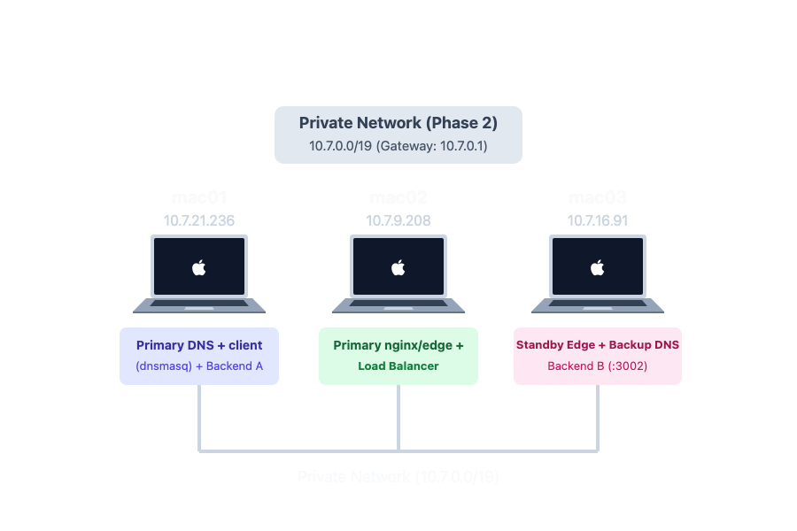
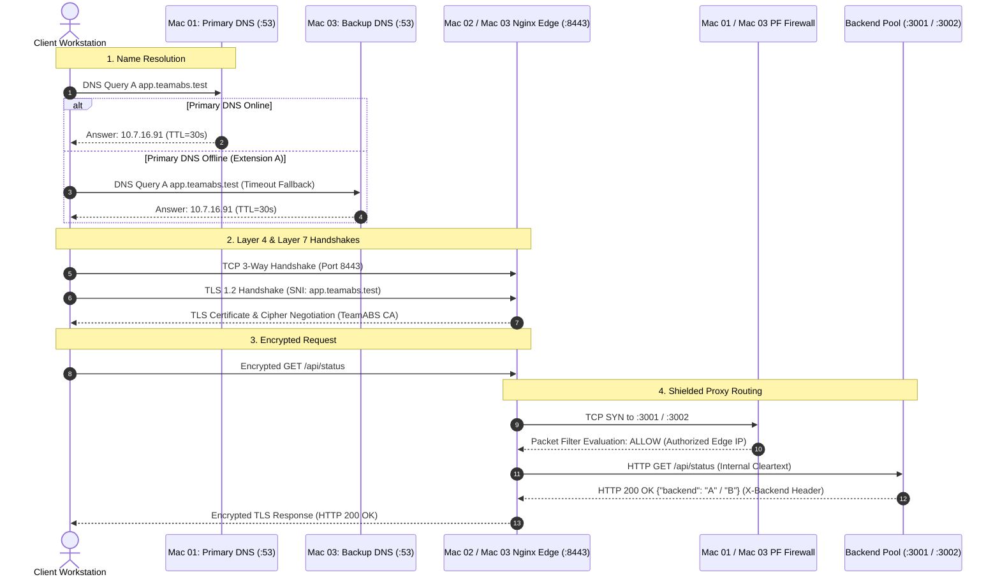
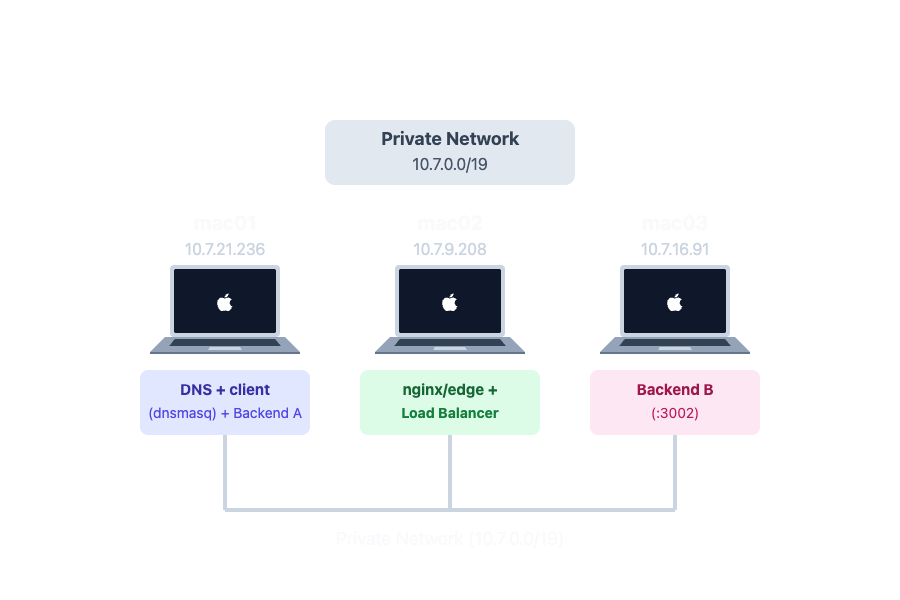
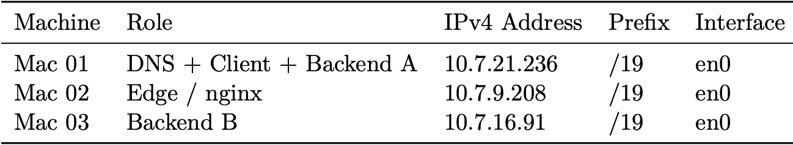
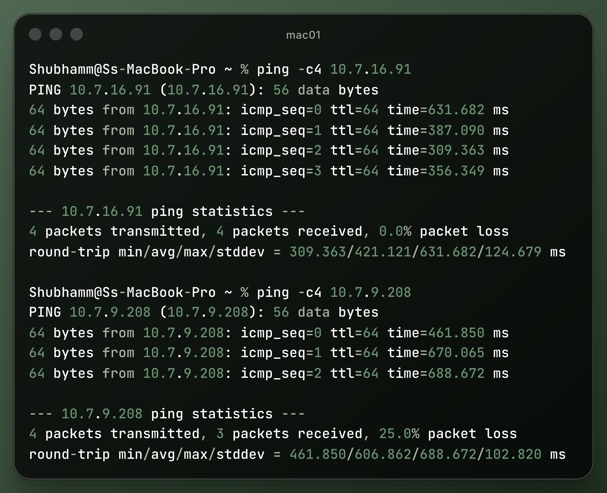
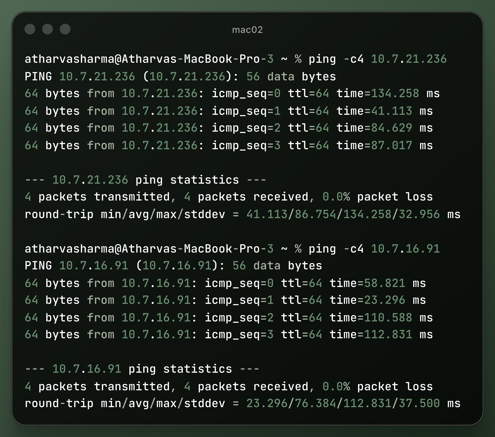
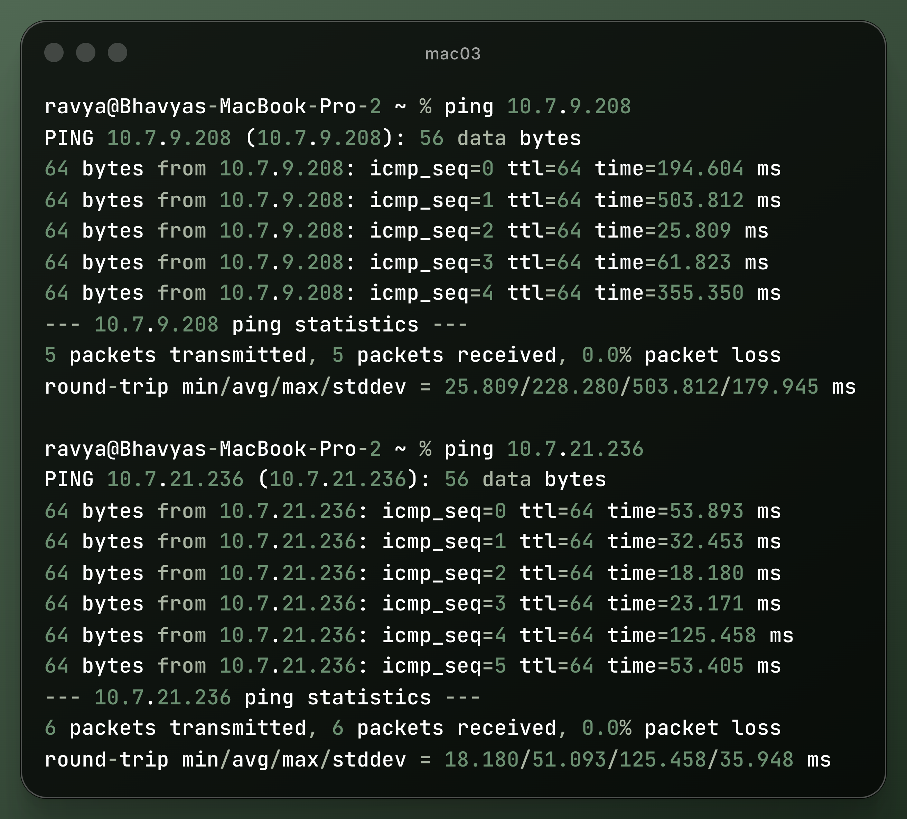

# Private LAN Architecture & Network Topology (Phase 1 & Phase 2)

This directory documents the physical and logical network architecture established across three physical macOS laptops on an isolated private local area network (`10.7.0.0/19`).

---

## 1. Network Addressing & Node Inventory

- **Network Subnet:** `10.7.0.0/19`
- **Subnet Mask:** `255.255.224.0`
- **Default Gateway:** `10.7.0.1`

| Machine | Team Member | IPv4 Address | Interface | Subnet / CIDR | Primary Roles |
|---|---|---|---|---|---|
| **Mac 01** | Shubham Aggarwal | `10.7.21.236` | `en0` | `255.255.224.0` (`/19`) | Primary DNS Resolver (`dnsmasq`), Test Client, Backend A (`:3001`), PF Firewall Anchor |
| **Mac 02** | Atharva Sharma | `10.7.9.208` | `en0` | `255.255.224.0` (`/19`) | Primary Nginx Edge Gateway, Reverse Proxy, Load Balancer, TLS Termination (`:8080`, `:8443`) |
| **Mac 03** | Bhavya Punj | `10.7.16.91` | `en0` | `255.255.224.0` (`/19`) | Standby Nginx Edge Gateway (`:8080`, `:8443`), Backup DNS Resolver (`dnsmasq`), Backend B (`:3002`), PF Firewall Anchor |

---

## 2. Phase 2 Resilient Architecture Overview

In Phase 2, the single-path architecture of Phase 1 was transformed into an active-redundant, defensively shielded distributed topology across the three physical Macs.

### 2.1 Core Architectural Components
1. **Redundant DNS Tier (Extension A):**
   - **Primary Resolver:** Mac 01 (`10.7.21.236:53`) with `local-ttl=30`.
   - **Backup Resolver:** Mac 03 (`10.7.16.91:53`) with identical zone records.
   - **Client Search Order:** Primary (`10.7.21.236`) &rarr; Secondary (`10.7.16.91`).
2. **Dual-Edge Reverse Proxy Tier (Extension E):**
   - **Primary Edge:** Mac 02 (`10.7.9.208`) terminating HTTP (`:8080`) and HTTPS (`:8443`).
   - **Standby Edge:** Mac 03 (`10.7.16.91`) terminating HTTP (`:8080`) and HTTPS (`:8443`) with mirrored SSL certificates.
3. **Dynamic Upstream Failover Tier (Extension D):**
   - Nginx upstream `teamabs_backends` configured with `max_fails=1 fail_timeout=5s`.
   - If Backend A (`10.7.21.236:3001`) fails, traffic is transparently diverted to Backend B (`10.7.16.91:3002`) in $< 50\text{ ms}$.
4. **Kernel Firewall Isolation Tier (Extension C):**
   - macOS Packet Filter (`pf`) anchors block raw client connections to origin ports `3001` and `3002`.
   - Authorized routes: Atharva (`10.7.9.208`) can access both backends; Bhavya (`10.7.16.91`) can access Backend A to facilitate standby edge reverse proxying.

---

## 3. Phase 1 vs. Phase 2 Architecture Comparison

| Architectural Property | Phase 1 Baseline Architecture | Phase 2 Resilient Architecture |
|---|---|---|
| **DNS Resolvers** | Single resolver on Mac 01 (`10.7.21.236`) | Active-passive dual resolvers on Mac 01 (`.236`) and Mac 03 (`.91`) |
| **DNS TTL** | Default local TTL | Authoritative `local-ttl=30` (30 seconds) |
| **`app.teamabs.test` Mapping** | `10.7.9.208` (Mac 02 Primary Edge) | `10.7.16.91` (Mac 03 Standby Edge) |
| **`api.teamabs.test` Mapping** | `10.7.9.208` (Mac 02 Primary Edge) | `10.7.9.208` (Mac 02 Primary Edge) |
| **Edge Gateways** | Single Nginx instance on Mac 02 | Primary edge on Mac 02; Standby edge on Mac 03 |
| **Backend Health Checks** | Static Round-Robin (no timeout policy) | Dynamic detection: `max_fails=1 fail_timeout=5s` |
| **Origin Access Security** | Unfiltered LAN access to ports 3001 & 3002 | Isolated via macOS PF anchors (`shubham-teamabs`, `bhavya-teamabs`) |

---

## 4. Application Request Flow (Phase 2)

---

## 5. Phase 1 Historical Baseline Assets

The original Phase 1 physical topology, IP inventory, and baseline ping reachability tests remain fully preserved:

### 5.1 Historical Physical Topology

### 5.2 Historical IP Inventory Asset

### 5.3 Baseline Inter-Node Ping Verification
- **Mac 01 Reachability (to Mac 02 and Mac 03):**
  
- **Mac 02 Reachability (to Mac 01 and Mac 03):**
  
- **Mac 03 Reachability (to Mac 01 and Mac 02):**
  
