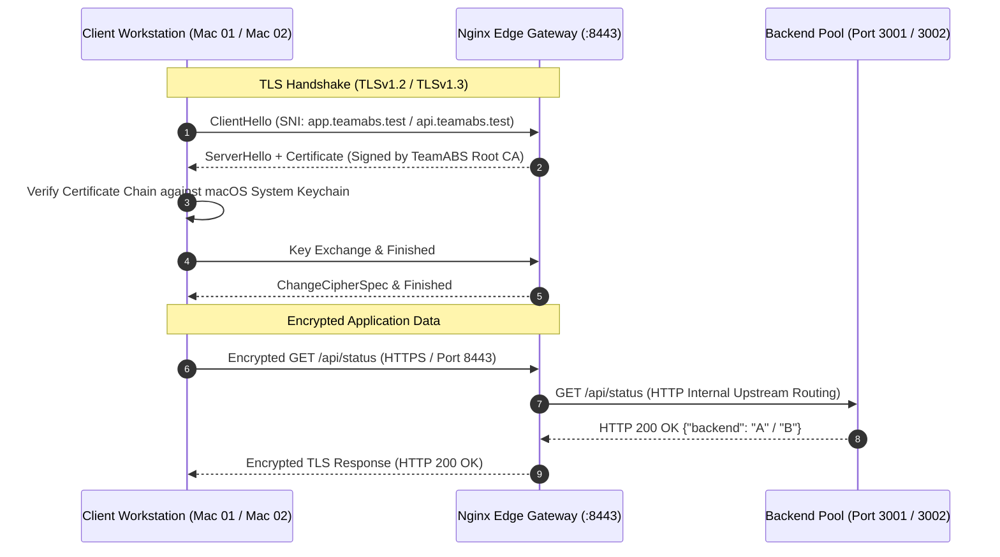

# Task E: Transport Layer Security (TLS/HTTPS) & Phase 2 Multi-Edge PKI

This directory documents the Public Key Infrastructure (PKI) setup, OpenSSL certificate generation, Subject Alternative Name (SAN) configuration, and Nginx reverse proxy SSL/TLS termination across both Phase 1 and Phase 2.

---

## 1. TLS Architecture & Multi-Edge PKI Overview

To secure client communication without relying on external commercial Certificate Authorities, TeamABS implemented a two-tier custom PKI model across the physical nodes:

1. **Root Certificate Authority (CA):** Generated offline to serve as the local trust anchor (`TeamABS Root CA`). In Phase 2, a corrected CA certificate (`cn-ca-v2.crt`) was generated using the existing CA private key (`cn-ca.key`), explicitly enforcing `CA:TRUE`, `pathlen:0`, `keyCertSign`, and `cRLSign`.
2. **Dual-Domain Server Certificates with SAN:** Modern TLS stacks (RFC 2818 / macOS / Chrome) require Subject Alternative Name (`subjectAltName`) extensions. The Phase 2 SAN configuration in [`san.cnf`](san.cnf) covers both project domains:
   - `app.teamabs.test`
   - `api.teamabs.test`
3. **Separate Edge Certificates with Zero Key Transfer:**
   - **Atharva's Primary Edge (Mac 02):** Generated a CSR from Atharva's existing Nginx server key, signed by the TeamABS CA, installed at `/opt/homebrew/etc/nginx/ssl/app.teamabs.test.crt`.
   - **Bhavya's Standby Edge (Mac 03):** Generated a separate CSR from Bhavya's own independent Nginx server key. Only the CSR file was transferred to Atharva for signing with the Root CA; the signed certificate and public CA were transferred back. **No server private keys were ever transferred across the network.**
4. **Client Trust Store:** The public Root CA (`cn-ca-v2.crt`) was imported and trusted in the macOS System Keychain on the client machines, enabling strict, trusted TLS verification without `-k` (`--insecure`).



---

## 2. OpenSSL Certificate Generation & Signing Workflow

### Step 1: Root CA Generation (Phase 2 Corrected CA)
The CA certificate enforces standard x509v3 basic constraints:
```bash
# Generate Root CA private key (4096-bit RSA - kept strictly offline)
openssl genrsa -out cn-ca.key 4096

# Generate Root CA self-signed certificate (cn-ca-v2.crt) with CA:TRUE
openssl req -x509 -new -nodes -key cn-ca.key -sha256 -days 365 \
  -out cn-ca-v2.crt \
  -subj "/C=IN/ST=Haryana/L=Sonepat/O=TeamABS/OU=CN Project/CN=TeamABS Root CA"
```

### Step 2: SAN Configuration ([`san.cnf`](san.cnf))
The Subject Alternative Name configuration defines both virtual hosts:
```ini
[req]
distinguished_name = req_distinguished_name
x509_extensions = v3_req
prompt = no

[req_distinguished_name]
C = IN
ST = Haryana
L = Sonepat
O = TeamABS
OU = CN Project
CN = app.teamabs.test

[v3_req]
subjectAltName = @alt_names

[alt_names]
DNS.1 = app.teamabs.test
DNS.2 = api.teamabs.test
```

### Step 3: Primary Server Certificate (Atharva — Mac 02)
```bash
# 1. Generate CSR on Mac 02 using Atharva's private key
openssl req -new -key app.teamabs.test.key -out atharva.csr -config san.cnf

# 2. Sign CSR with Root CA (offline / local)
openssl x509 -req -in atharva.csr \
  -CA cn-ca-v2.crt -CAkey cn-ca.key -CAcreateserial \
  -out app.teamabs.test.crt -days 365 -sha256 \
  -extfile san.cnf -extensions v3_req

# 3. Install certificate on Mac 02
sudo cp app.teamabs.test.crt /opt/homebrew/etc/nginx/ssl/app.teamabs.test.crt
```

### Step 4: Standby Server Certificate (Bhavya — Mac 03)
```bash
# 1. Generate separate CSR on Mac 03 using Bhavya's own server key
openssl req -new -key app.teamabs.test.key -out bhavya.csr -config san.cnf

# 2. Transfer only bhavya.csr to Atharva (zero private key movement)
# 3. Sign Bhavya's CSR on Atharva's Mac using TeamABS Root CA
openssl x509 -req -in bhavya.csr \
  -CA cn-ca-v2.crt -CAkey cn-ca.key -CAcreateserial \
  -out bhavya_app.teamabs.test.crt -days 365 -sha256 \
  -extfile san.cnf -extensions v3_req

# 4. Transfer signed certificate back to Mac 03 and install
sudo cp bhavya_app.teamabs.test.crt /opt/homebrew/etc/nginx/ssl/app.teamabs.test.crt
```

### Step 5: Install and Trust Root CA in macOS System Keychain
Executed on Atharva's Mac and Bhavya's Mac:
```bash
sudo security add-trusted-cert -d -r trustRoot \
  -k /Library/Keychains/System.keychain cn-ca-v2.crt
```

---

## 3. Nginx TLS Edge Configuration

Both Primary Edge ([`04_Nginx/Phase2/primary-edge.conf`](../04_Nginx/Phase2/primary-edge.conf)) and Standby Edge ([`04_Nginx/Phase2/standby-edge.conf`](../04_Nginx/Phase2/standby-edge.conf)) terminate TLS on port 8443:

```nginx
server {
    listen 8443 ssl;
    server_name app.teamabs.test api.teamabs.test;

    ssl_certificate     /opt/homebrew/etc/nginx/ssl/app.teamabs.test.crt;
    ssl_certificate_key /opt/homebrew/etc/nginx/ssl/app.teamabs.test.key;

    ssl_protocols TLSv1.2 TLSv1.3;
    ssl_ciphers HIGH:!aNULL:!MD5;

    location / {
        proxy_pass http://teamabs_backends;

        proxy_set_header Host $host;
        proxy_set_header X-Real-IP $remote_addr;
        proxy_set_header X-Forwarded-For $proxy_add_x_forwarded_for;
        proxy_set_header X-Forwarded-Proto $scheme;
    }
}
```

---

## 4. Verification & Testing

### 4.1 Certificate SAN Inspection via OpenSSL
```bash
openssl x509 -in /opt/homebrew/etc/nginx/ssl/app.teamabs.test.crt -noout -text | grep -A 2 "Subject Alternative Name"
```
**Output:**
```text
X509v3 Subject Alternative Name: 
    DNS:app.teamabs.test, DNS:api.teamabs.test
```

### 4.2 Certificate Chain Verification
```bash
openssl verify -CAfile ~/cn-ca-v2.crt /opt/homebrew/etc/nginx/ssl/app.teamabs.test.crt
# Output: /opt/homebrew/etc/nginx/ssl/app.teamabs.test.crt: OK
```

### 4.3 Trusted HTTPS Requests (Without `-k` Flag)
```bash
# Verify app domain over HTTPS
curl -iv https://app.teamabs.test:8443/api/status

# Verify api domain over HTTPS
curl -iv https://api.teamabs.test:8443/api/status
```
**Verification Evidence:**
- `* Server certificate: subject: C=IN, ST=Haryana, L=Sonepat, O=TeamABS, OU=CN Project, CN=app.teamabs.test`
- `* Server certificate: issuer: C=IN, ST=Haryana, L=Sonepat, O=TeamABS, OU=CN Project, CN=TeamABS Root CA`
- `* SSL certificate verify ok.`
- `HTTP/1.1 200 OK`

---

## 5. Security & Key Management Hygiene

> [!CAUTION]
> **Zero Private Key Tracking Policy:**
> - In strict accordance with RFC 5280 and Git security best practices, **no private keys (`*.key`), PKCS#12 bundles (`*.p12`, `*.pfx`), Certificate Signing Requests (`*.csr`), or CA serial files (`*.srl`) are committed to this repository**.
> - All private key material is excluded via [`.gitignore`](../.gitignore).
> - Server private keys never left their respective origin hardware.
