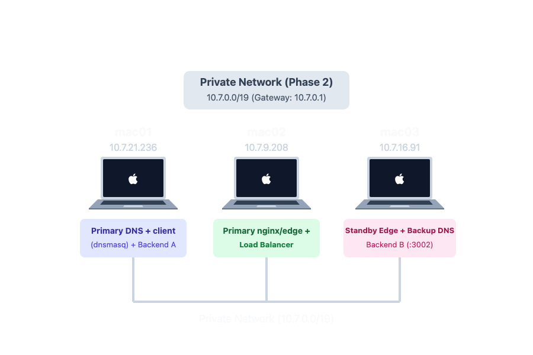
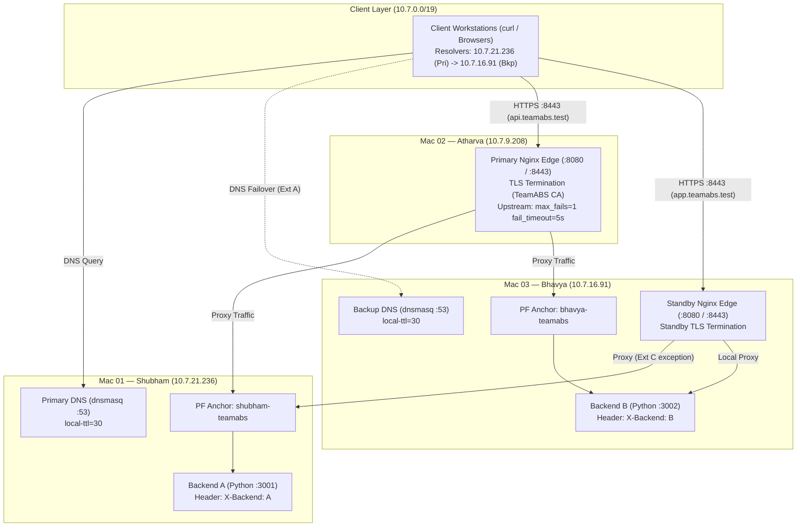

# TeamABS — Distributed Systems & Computer Networks Project
## Phase 1 Baseline & Phase 2 High Availability Engineering

**GitHub Repository:** [https://github.com/Shubham-60/TeamABS](https://github.com/Shubham-60/TeamABS)  
**Team Name:** TeamABS  
**Network Subnet:** `10.7.0.0/19` | **Netmask:** `255.255.224.0` | **Default Gateway:** `10.7.0.1`

---

## 1. Project Overview

**TeamABS** is a distributed networks and systems engineering project implemented natively across three physical Apple Silicon macOS laptops on an isolated private local area network.

The project demonstrates:
1. **Phase 1 (Baseline Distributed Architecture):** Private DNS resolution with `dnsmasq`, multi-node Python REST microservices, Nginx reverse proxying with round-robin load balancing, custom Public Key Infrastructure (PKI) with Subject Alternative Name (SAN) validation, RFC 7234 HTTP caching with `ETag` and `304 Not Modified`, Wireshark packet dissection, and 5 intentional failure injection tests.
2. **Phase 2 (High Availability & Origin Shielding):** Redundant active-passive DNS resolvers with deterministic client failover order (Extension A), authoritative 30-second DNS TTL policy and empirical client cache dynamics (Extension B), origin perimeter isolation via macOS Packet Filter (`pf`) anchors (Extension C), dynamic upstream health detection and sub-second backend failover (Extension D), and active-standby physical edge reverse proxy migration (Extension E).

---

## 2. Team Members, Hardware & IP Inventory

| Machine | Member | IPv4 Address | Interface | Subnet / CIDR | Primary Architectural Roles |
|---|---|---|---|---|---|
| **Mac 01** | Shubham Aggarwal | `10.7.21.236` | `en0` | `255.255.224.0` (`/19`) | Primary DNS Resolver (`dnsmasq`), Backend A Service (`:3001`), PF Firewall Anchor, Client |
| **Mac 02** | Atharva Sharma | `10.7.9.208` | `en0` | `255.255.224.0` (`/19`) | Primary Nginx Edge Gateway, TLS Termination, Upstream Load Balancer (`:8080`, `:8443`) |
| **Mac 03** | Bhavya Punj | `10.7.16.91` | `en0` | `255.255.224.0` (`/19`) | Standby Nginx Edge Gateway (`:8080`, `:8443`), Backup DNS Resolver (`dnsmasq`), Backend B Service (`:3002`), PF Firewall Anchor |

---

## 3. Important Network Ports & Domains

### Port Allocations
- **DNS (UDP/TCP):** `53`
- **Plaintext HTTP Ingress:** `8080`
- **Encrypted HTTPS Ingress (TLS 1.2/1.3):** `8443`
- **Origin Backend A (REST):** `3001`
- **Origin Backend B (REST):** `3002`

### Project Domain Names & DNS Mappings

> [!IMPORTANT]
> **Distinction Between Phase 1 and Phase 2 DNS Mappings:**
> - **Phase 1 Baseline Mapping:**
>   - `app.teamabs.test -> 10.7.9.208` (Atharva — Mac 02 Primary Edge)
>   - `api.teamabs.test -> 10.7.9.208` (Atharva — Mac 02 Primary Edge)
>   - Configured in [`02_DNS/dnsmasq.conf`](02_DNS/dnsmasq.conf)
> - **Phase 2 Restored Mapping:**
>   - `app.teamabs.test -> 10.7.16.91` (Bhavya — Mac 03 Standby Edge)
>   - `api.teamabs.test -> 10.7.9.208` (Atharva — Mac 02 Primary Edge)
>   - Authoritative `local-ttl=30` (30 seconds)
>   - Deployed in `02_DNS/Phase2/` (`primary-dnsmasq.conf` and `backup-dnsmasq.conf`)

---

## 4. Architecture Diagrams

### Phase 2 High Availability Topology




---

## 5. Phase 1 Accomplishments Summary

1. **Task A: Network Subnet:** Full Layer 3 reachability established across 3 laptops with static routing on `10.7.0.0/19`.
2. **Task B: Private DNS Resolver:** `dnsmasq` deployed on Mac 01 resolving local `.test` domains.
3. **Task C: Python REST Microservices:** Distributed backends on ports 3001 and 3002 emitting custom `X-Backend` headers.
4. **Task D: Reverse Proxy & Load Balancing:** Nginx deployed on Mac 02 with round-robin traffic distribution.
5. **Task E: Custom PKI & TLS Termination:** Root CA generation, SAN certificate signing, macOS keychain trust installation, and TLS 1.2 termination on port 8443.
6. **Task F: HTTP Caching Semantics:** Implementation and verification of `Cache-Control: max-age=60`, `ETag: "teamabs-v1"`, and `HTTP 304 Not Modified`.
7. **Task G: Protocol Captures:** Full-stack Wireshark analysis across DNS, TCP 3-way handshakes, TLS 1.2 handshakes, and cleartext internal proxy flows.
8. **Task H: Systematic Fault Injection:** 5 verified failure demonstrations (wrong DNS server, wrong IP record, single backend down, both backends down, wrong port).

---

## 6. Phase 2 Extensions (A through E)

| Extension | Title | Core Architectural Achievement | Key Test & Verification | Status |
|---|---|---|---|---|
| **Extension A** | Backup DNS Failover | Dual redundant DNS resolvers (Mac 01 primary, Mac 03 backup) | Primary DNS killed; client seamlessly queried backup; application continued without interruption | **100% Verified** |
| **Extension B** | DNS TTL & Propagation | Authoritative 30s TTL (`local-ttl=30`) and dynamic record alteration | Configured 30s TTL verified in answers; record modified, flushed, and restored. Client-side stale cache holding limitation accurately documented | **Verified (with limitation)** |
| **Extension C** | Origin Firewall Isolation | Layer 4 host shielding via macOS Packet Filter (`pf`) anchors | Raw client access to origin ports blocked; authorized reverse proxies allowed. Bhavya-to-Backend-A standby exception documented | **100% Verified** |
| **Extension D** | Backend High Availability | Dynamic health detection in Nginx (`max_fails=1 fail_timeout=5s`) | Backend A stopped; Nginx automatically rerouted 100% of requests to Backend B with zero dropped requests; round-robin auto-recovered | **100% Verified** |
| **Extension E** | Edge Reverse Proxy Migration | Active-standby physical edge failover across hardware | Standby Nginx edge verified on Bhavya with valid TLS; primary edge stopped; traffic served via standby edge | **100% Verified** |

> [!NOTE]
> **Faculty Viva Note Regarding Extension F:**
> Extension F is intentionally omitted from the standard Phase 2 report and presentation. It is reserved for the faculty viva as an interactive, live troubleshooting exercise. The original Phase 1 failure demonstrations remain fully preserved in [`08_Failures/`](08_Failures/).

---

## 7. Repository Directory Guide

```text
TeamABS/
├── .gitignore                          # Version control exclusions (keys, env, bytecode)
├── README.md                           # Main comprehensive documentation index
│
├── 01_Architecture/                    # Topology diagrams, IP inventory, ping tests
│   ├── Phase2_Topology.png             # Phase 2 high-availability architecture diagram
│   ├── Topology.png                    # Historical Phase 1 topology
│   ├── IP_inventory.png                # Historical Phase 1 IP inventory
│   └── README.md                       # Comprehensive architecture documentation
│
├── 02_DNS/                             # DNS configurations and resolution evidence
│   ├── Phase2/                         # Phase 2 Redundant DNS configurations
│   │   ├── primary-dnsmasq.conf        # Primary DNS resolver config (Mac 01)
│   │   ├── backup-dnsmasq.conf         # Backup DNS resolver config (Mac 03)
│   │   └── README.md                   # Phase 2 DNS documentation
│   ├── dnsmasq.conf                    # Historical Phase 1 single-resolver configuration
│   └── README.md                       # Historical Phase 1 DNS documentation
│
├── 03_Backends/                        # Origin Python REST microservices
│   ├── backend_A/                      # Backend A microservice on port 3001 (Mac 01)
│   │   ├── server.py                   # Python HTTP server implementation
│   │   └── backend_a_direct_curl.png   # Verification screenshot
│   ├── Backend_B/                      # Backend B microservice on port 3002 (Mac 03)
│   │   ├── server.py                   # Python HTTP server implementation
│   │   └── backend_b_direct_curl.png   # Verification screenshot
│   └── README.md                       # Microservice endpoints and specifications
│
├── 04_Nginx/                           # Reverse proxy and load balancing
│   ├── Phase2/                         # Phase 2 Edge configurations
│   │   ├── primary-edge.conf           # Primary Nginx edge config (Mac 02)
│   │   ├── standby-edge.conf           # Standby Nginx edge config (Mac 03)
│   │   └── README.md                   # Phase 2 edge documentation
│   ├── nginx.conf                      # Historical Phase 1 Nginx configuration
│   └── README.md                       # Historical Phase 1 Nginx documentation
│
├── 05_TLS/                             # Custom PKI & Transport Layer Security
│   ├── nginx_tls.conf                  # Nginx TLS server block definition
│   ├── san.cnf                         # OpenSSL Subject Alternative Name configuration
│   └── README.md                       # PKI generation steps, CA trust, and curl checks
│
├── 06_Caching/                         # RFC 7234 HTTP caching validation
│   ├── cache_headers.txt               # Raw header outputs (ETag, max-age, 304 Not Modified)
│   ├── cache_headers_response.png      # Initial 200 OK with cache headers
│   ├── cache_conditional_304.png       # Conditional If-None-Match 304 response
│   └── README.md                       # Caching mechanics and lifecycle explanation
│
├── 07_Wireshark/                       # Historical Phase 1 packet captures
│   ├── nginx_backend_load_balancing.pcapng
│   ├── tlsv1.2_handshake_and_traffic.pcapng
│   ├── tls_certificate_exchange.pcapng
│   ├── tcp_tls_handshake.pcapng
│   └── README.md                       # Wireshark filter mappings and flow breakdowns
│
├── 08_Failures/                        # Historical Phase 1 failure demonstrations
│   └── README.md                       # 5 fault-injection scenarios and lessons learned
│
├── 09_Documentation/                   # Formal project engineering reports
│   ├── README.md                       # Documentation index
│   └── documentation.pdf               # Historical 36-page Phase 1 formal PDF report
│
├── 10_Firewall/                        # macOS Packet Filter (PF) host isolation (.gitkeep)
│
├── 11_Phase2_Evidence/                 # Phase 2 experimental logs and capture indices
│   ├── Extension_A_Backup_DNS/         # (.gitkeep)
│   ├── Extension_B_DNS_TTL/            # (.gitkeep)
│   ├── Extension_C_Firewall/           # (.gitkeep)
│   ├── Extension_D_Backend_Failover/   # (.gitkeep)
│   ├── Extension_E_Edge_Migration/     # (.gitkeep)
│   └── Wireshark/                      # (.gitkeep)
│
└── 12_Presentation/                    # Evaluation slide deck outline (.gitkeep)
```

---

## 8. Direct Documentation & Deliverable Links

- **Phase 1 Formal PDF Report:** [`09_Documentation/documentation.pdf`](09_Documentation/documentation.pdf)
- **Phase 2 Network Architecture:** [`01_Architecture/Phase2_Topology.png`](01_Architecture/Phase2_Topology.png)
- **Phase 2 Primary DNS Config:** [`02_DNS/Phase2/primary-dnsmasq.conf`](02_DNS/Phase2/primary-dnsmasq.conf)
- **Phase 2 Backup DNS Config:** [`02_DNS/Phase2/backup-dnsmasq.conf`](02_DNS/Phase2/backup-dnsmasq.conf)
- **Phase 2 DNS Architecture & Failover Guide:** [`02_DNS/Phase2/README.md`](02_DNS/Phase2/README.md)
- **Phase 2 Primary Edge Config:** [`04_Nginx/Phase2/primary-edge.conf`](04_Nginx/Phase2/primary-edge.conf)
- **Phase 2 Standby Edge Config:** [`04_Nginx/Phase2/standby-edge.conf`](04_Nginx/Phase2/standby-edge.conf)
- **Phase 2 Edge & Failover Guide:** [`04_Nginx/Phase2/README.md`](04_Nginx/Phase2/README.md)
- **Phase 1 Historical Topology:** [`01_Architecture/Topology.png`](01_Architecture/Topology.png)
- **Phase 1 Failure Demonstrations:** [`08_Failures/README.md`](08_Failures/README.md)
- **Phase 1 Wireshark Captures:** [`07_Wireshark/README.md`](07_Wireshark/README.md)
- **Documentation Index:** [`09_Documentation/README.md`](09_Documentation/README.md)
